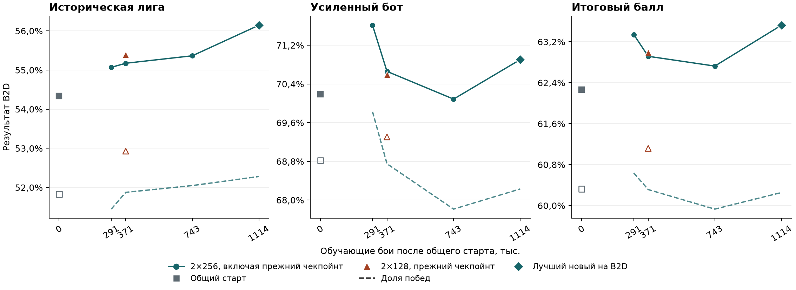

# Длительное обучение 2×256 на B2D

Общий стартовый чекпойнт получен после 1300 обновлений PPO по 384 боя. Новый прогон продолжил обучение 2×256 с чекпойнта на 757-м обновлении. Точка 967 совпадает по числу обучающих боёв с прежним 2×128. Отсчёт боёв начинается с развилки ширин, после общего этапа обучения. Продолжение использовало сохранённые веса и состав лиги прежнего 2×256 и заново инициализировало Adam.

На одного соперника приходится 2880 боёв. Расписание покрывает все 12×12 упорядоченных пар классов, уровни 1–5, две арены и обе рассадки. Нейросетевые политики жадно выбирают разрешённые действия. Балл учитывает половину очка за ничью. Итог даёт равный вес среднему по трём историческим политикам и усиленному боту. Доля побед вычисляется с теми же весами.

В рейтинге новых точек порядок задаёт точный итоговый балл B2D, при равенстве ранняя точка выше. Чекпойнт 2901 зафиксирован заранее как конечная точка. Точки 967, 1934 и 2901 соответствуют одному, двум и трём бюджетам дуэлей прежней узкой сети.

| Чекпойнт | Обновления после старта | Боёв после старта | Лига, балл / победы | Бот, балл / победы | Итог, балл / победы |
|---|---:|---:|---:|---:|---:|
| Общий старт | 0 | 0 | 54,34% / 51,83% | 70,19% / 68,82% | 62,27% / 60,32% |
| 2×256, прежний чекпойнт | 757 | 290 688 | 55,07% / 51,45% | 71,61% / 69,83% | 63,34% / 60,64% |
| 2×128, прежний чекпойнт | 967 | 371 328 | 55,39% / 52,93% | 70,59% / 69,31% | 62,99% / 61,12% |
| 2×256, 967 обновлений | 967 | 371 328 | 55,17% / 51,87% | 70,66% / 68,75% | 62,92% / 60,31% |
| 2×256, 1934 обновлений | 1934 | 742 656 | 55,36% / 52,05% | 70,09% / 67,81% | 62,73% / 59,93% |
| 2×256, 2901 обновлений | 2901 | 1 113 984 | 56,15% / 52,28% | 70,90% / 68,23% | 63,52% / 60,25% |

Порядок новых чекпойнтов по B2D от лучшего к худшему — 2901 → 967 → 1934.



Расписание, хэши библиотеки и соперников сохранены в `manifest.json`. Хэши чекпойнтов и результаты по каждому сопернику и рассадке сохранены в `curve.json`. Для построения графика нужен Matplotlib.

```sh
export PYTHONPATH=/tmp/dnd-spec-frozen-621964e7/python OPENBLAS_NUM_THREADS=1 VECLIB_MAXIMUM_THREADS=1
.venv/bin/python evaluation/long_width_curve.py --plot
```
