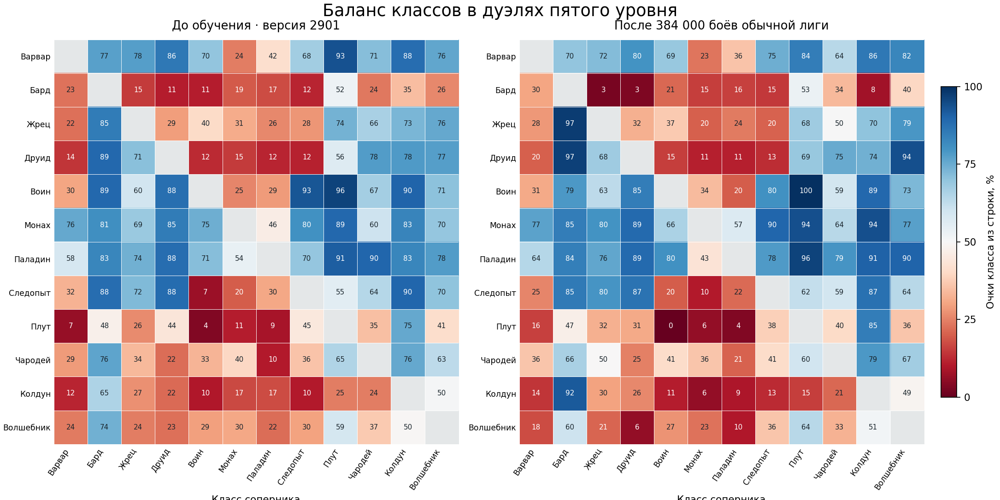

# Версия 2901 после дообучения на 36 сборках пятого уровня

Сеть 2×256 после 384 000 боёв обычной лиги набрала 57,03% очков в очной игре с исходным файлом 2901 и 68,71% против усиленного бота. На старте дообучения сеть набирала против того же бота 63,89%. Победа даёт одно очко, ничья — половину. Финальная сеть чаще доводит поединок до победы одной из сторон. Доля разгромов среди всех боёв практически та же.

## Сила сети

| Кто играет | Соперник | Победы | Ничьи | Поражения | Очки, % (95% ДИ) |
| --- | --- | ---: | ---: | ---: | ---: |
| Исходный файл 2901 | Усиленный бот | 62 068 | 6 168 | 35 444 | 62,84 (62,63–63,05) |
| 2901 на старте дообучения | Усиленный бот | 63 385 | 5 711 | 34 584 | 63,89 (63,68–64,10) |
| Финальная сеть | Усиленный бот | 69 484 | 3 505 | 30 691 | 68,71 (68,50–68,91) |
| Финальная сеть | 2901 на старте дообучения | 55 226 | 6 486 | 41 968 | 56,39 (56,19–56,59) |
| Финальная сеть | Исходный файл 2901 | 55 697 | 6 871 | 41 112 | 57,03 (56,83–57,23) |

При переходе на расширенный набор сборок тренер обнулил веса для 29 входных признаков, зарезервированных в старой сети. Эффект самого дообучения против бота составил **+4,82 п.п.** к этому старту (парный 95% ДИ от +4,57 до +5,06). Выигрыш относительно исходного файла составил +5,87 п.п. Прибавка наблюдалась на всех пяти аренах. По классам сильнее всего выросли друид (+8,65 п.п.) и паладин (+8,56 п.п.). Для волшебника изменение составило +0,08 п.п. с интервалом от −0,60 до +0,77. [Результаты по классам и аренам](strength.md)

## Баланс пар и разгромы

В каждом столбце один контроллер играл за обе стороны. На контроллер пришлось 51 840 боёв. Разгром — нокаут с остатком у победителя не менее 75% максимальных HP. Временные HP в расчёт не входят. Разрыв пары — абсолютное отклонение её результата от 50% очков.

| Показатель | Исходный файл 2901 | Старт обучения | Финал | Усиленный бот |
| --- | ---: | ---: | ---: | ---: |
| Средний разрыв между классами, п.п. | 25,35 | 25,37 | 26,53 | 30,77 |
| Средний разрыв между сборками, п.п. | 26,77 | 26,64 | 28,12 | 32,29 |
| Пар классов с измеренным результатом 80/20 или выше, из 66 | 23 | 23 | 27 | 36 |
| Пар сборок с измеренным результатом 80/20 или выше, из 630 | 295 | 293 | 322 | 406 |
| Разгромы среди всех боёв | 37,04% | 35,70% | 35,77% | 53,15% |
| Разгромы среди нокаутов с одним победителем | 41,53% | 39,87% | 37,40% | 54,68% |

Средний разрыв от старта к финалу вырос на 1,16 п.п. для классов (95% ДИ от +0,76 до +1,56) и на 1,48 п.п. для сборок (от +1,16 до +1,91). Пороговые подсчёты зависят от выборки. На пару сборок пришлось 80 боёв, на пару классов — 720. Например, результат барда против колдуна упал с 34,65% до 8,12%, а пара жрец — чародей приблизилась к равенству, с 66,25% до 50,14% у жреца.

Ничьих стало 2 260 вместо 5 419. В частности, число ничьих по лимиту решений упало с 4 804 до 1 708. Если считать только бои с победителем, среднее отклонение доли побед от 50% у пар классов снизилось с 28,83 до 27,96 п.п. (парное изменение −0,87 п.п., 95% ДИ от −1,27 до −0,44). У пар сборок оно снизилось с 30,10 до 29,54 п.п. Таким образом, вывод для очков всех боёв чувствителен к тому, что ничья приносит обеим сторонам половину очка. [Проверка на боях с победителем](decisive-balance.json)

Число разгромов выросло с 18 506 до 18 543, доля среди всех боёв изменилась на +0,07 п.п. (95% ДИ от −0,40 до +0,50). Всего нокаутов с победителем стало 49 580 вместо 46 421. Среди таких нокаутов доля разгромов снизилась на 2,47 п.п. (95% ДИ от −2,96 до −2,01).

[Таблица пар сборок](balance-build-pairs.csv) · [Таблица пар классов](balance-class-pairs.csv) · [Полная статистика баланса](balance.md)

## Как проводился эксперимент

Финальный чекпойнт был выбран заранее — ровно 1 000 новых обновлений PPO по 384 боя. Все 36 сборок играли на пятом уровне, каждая упорядоченная пара участвовала в 148–149 учебных сериях со сменой сторон. На каждую арену пришлось 76 800 учебных боёв. Лига включала текущую сеть, версии 967, 1934, 2901 и ранее сохранённые версии этой тренировки. Специалистов в лиге было ноль. [Настройки обучения](../../training/runs/roster-2901-league/README.md) · [Проверка чекпойнта](../../training/runs/roster-2901-league/verification.json) · [Веса финальной сети](../../training/runs/roster-2901-league/checkpoints/update-1000.npz)

В финальных тестах сети выбирали разрешённое действие с максимальной оценкой. Все проверки использовали [одно расписание](fixtures.npz) с 26 640 новыми блоками случайности. Оно охватывает пять арен и все 666 неупорядоченных пар сборок с учётом зеркал. По каждой паре и арене взяты восемь семян. У смешанных соперников сбалансированы и назначение сборки, и сторона поля. Всего сыграно 518 400 боёв на силу и 207 360 на баланс. Интервалы отражают случайность боёв при фиксированных сетях. Опыт обучения проведён один раз.
