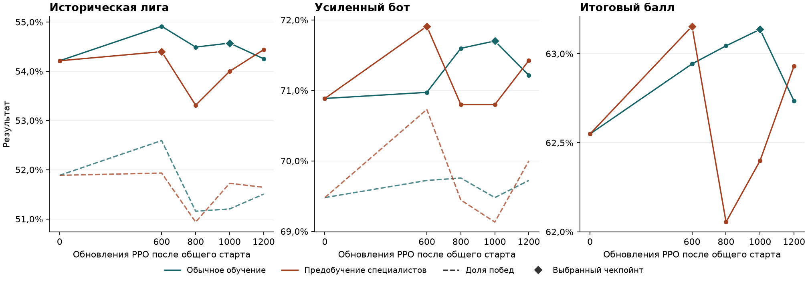

# Выбор чекпойнтов на M1D

Обе ветки начинают с чекпойнта исторической лиги после 1300 обновлений. Обычная ветка выполняет 1200 основных обновлений. Ветка со специалистами тратит 400 обновлений на предобучение специалистов и 800 на основное обучение. Каждое обновление использует 384 боя.

Расписание покрывает все 12×12 упорядоченных пар классов и уровни 1–5. На каждую пару и уровень приходятся две арены и обе рассадки. Четыре арены равномерно представлены для каждого класса на каждом уровне. На одного соперника приходится 2880 боёв и 780 разных сидов. На ничью приходится пол-очка. Итоговый балл поровну учитывает средние очки против трёх исторических сетей и очки против усиленного бота.

У каждой ветки четыре точки выбора с одинаковым суммарным бюджетом. При равенстве баллов выбирается более ранняя точка.

| Ветка | Всего обновлений | Основных обновлений | Лига | Усиленный бот | Итоговый балл |
|---|---:|---:|---:|---:|---:|
| Общий старт | 0 | 0 | 54,21% | 70,89% | 62,55% |
| Обычное обучение | 600 | 600 | 54,91% | 70,97% | 62,94% |
| **Предобучение специалистов** | 600 | 200 | 54,40% | 71,91% | 63,15% |
| Обычное обучение | 800 | 800 | 54,49% | 71,60% | 63,04% |
| Предобучение специалистов | 800 | 400 | 53,31% | 70,80% | 62,05% |
| **Обычное обучение** | 1000 | 1000 | 54,57% | 71,70% | 63,14% |
| Предобучение специалистов | 1000 | 600 | 54,00% | 70,80% | 62,40% |
| Обычное обучение | 1200 | 1200 | 54,25% | 71,22% | 62,73% |
| Предобучение специалистов | 1200 | 800 | 54,44% | 71,42% | 62,93% |

При одинаковых 800 обновлениях основного обучения ветка со специалистами дала 62,93% против 63,04% у обычной ветки (-0,11 п. п.). Это дополнительное сравнение на M1D. Ветка со специалистами здесь израсходовала на 400 обновлений больше.

Для веток учитывается процессорное время четырёх DEV-оценок. Оценка общего старта выполнена один раз.

| Оценка | Процессорное время, с |
|---|---:|
| Обычное обучение | 134,81 |
| Предобучение специалистов | 134,01 |
| Общий старт | 30,90 |



Полное расписание находится в `manifest.json`, а хэши и результаты чекпойнтов в `curve.json`. Для воспроизведения из корня репозитория после `make release` выполните

```sh
export PYTHONPATH=python OPENBLAS_NUM_THREADS=1 VECLIB_MAXIMUM_THREADS=1
.venv/bin/python evaluation/specialist_curve.py --output /tmp/specialist-dev
```

Если используете замороженную сборку, укажите её каталог `python` в `PYTHONPATH`. Для изображения добавьте `--plot` и установите Matplotlib в используемое окружение.
