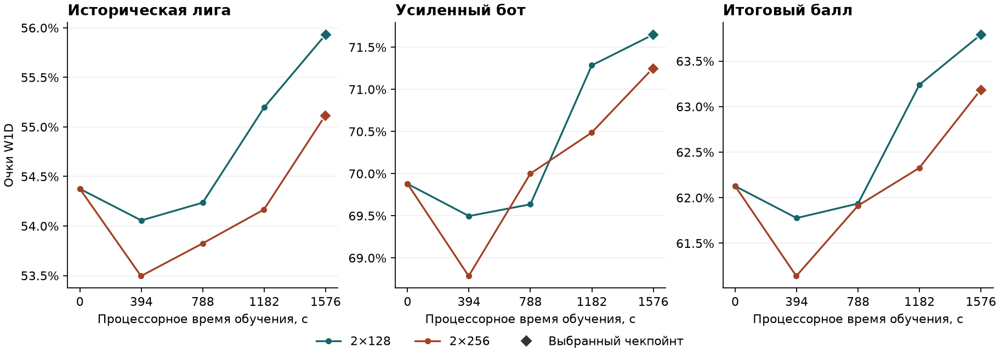

# Ширина сети на W1D

Сравнение 2×128 и 2×256 при одинаковом лимите 1576 процессорных секунд обучения. Обе сети наследуют политику после 1300 обновлений. Широкая сеть получает её через расширение скрытых слоёв. Начальные политики показаны как ориентир.

2880 боёв на соперника покрывают 12×12 упорядоченных пар классов, уровни 1–5, две арены на пару и уровень и обе рассадки. Оценки используют одни и те же сиды W1D. Нейросетевые политики жадно выбирают разрешённые действия. Победа приносит очко, ничья пол-очка. Итоговый балл поровну учитывает среднее по трём историческим сетям и очки против усиленного бота.

Для каждой ширины выбирается лучший чекпойнт из 25%, 50%, 75% и 100% лимита. При точном равенстве выигрывает более ранняя точка. Таблица выделяет выбранные точки.

| Сеть | Лимит | Процессорное время обучения, с | Обновления | Лига | Бот | Итог | DEV CPU, с |
|---|---:|---:|---:|---:|---:|---:|---:|
| 2×128 | 0% | 0.00 | 0 | 54,38% | 69,88% | 62,13% | 41.44 |
| 2×128 | 25% | 393.79 | 247 | 54,06% | 69,50% | 61,78% | 42.70 |
| 2×128 | 50% | 787.79 | 485 | 54,24% | 69,64% | 61,94% | 42.02 |
| 2×128 | 75% | 1181.82 | 725 | 55,20% | 71,28% | 63,24% | 39.76 |
| **2×128** | 100% | 1575.78 | 967 | 55,93% | 71,65% | 63,79% | 40.41 |
| 2×256 | 0% | 0.00 | 0 | 54,38% | 69,88% | 62,13% | 46.12 |
| 2×256 | 25% | 391.94 | 197 | 53,50% | 68,78% | 61,14% | 57.87 |
| 2×256 | 50% | 787.73 | 386 | 53,83% | 70,00% | 61,91% | 57.93 |
| 2×256 | 75% | 1180.49 | 574 | 54,17% | 70,49% | 62,33% | 59.97 |
| **2×256** | 100% | 1573.87 | 757 | 55,12% | 71,25% | 63,18% | 62.75 |

Четыре DEV-оценки заняли 164.89 с CPU для 2×128 и 238.53 с CPU для 2×256. Эти расходы и оценки начальных политик учтены отдельно от лимита обучения. Время включает симуляцию боёв и инференс.

У начальных сетей совпали сводки по победам, ничьим, поражениям и причинам завершения для каждого соперника.



Хэши чекпойнтов и результаты находятся в `curve.json`, расписание и хэш библиотеки в `manifest.json`. Для воспроизведения запустите из корня репозитория с обученными чекпойнтами, собранной release-библиотекой и Matplotlib.

```sh
export PYTHONPATH=python OPENBLAS_NUM_THREADS=1 VECLIB_MAXIMUM_THREADS=1
.venv/bin/python evaluation/width_curve.py --output /tmp/width-dev --plot
```

Для замороженной сборки подставьте её каталог `python` в `PYTHONPATH` и сверяйте SHA-256 библиотеки с манифестом.
